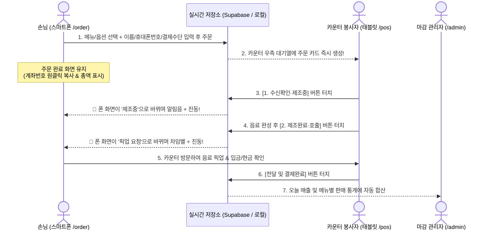

# 교회 선교카페 주문 & POS 시스템 전체 정리 가이드

지금까지 기획하고 개발한 **교회 선교카페 웹 기반 주문 및 POS 시스템**의 전체 구조와 작동 원리, 화면별 기능, 그리고 각 코드 파일이 하는 역할을 한눈에 이해하실 수 있도록 정리한 문서입니다.

---

## 1. 이 시스템은 어떻게 돌아가나요? (전체 흐름도)

우리 시스템은 **별도의 유료 포스기나 은행 유료 API 없이**, **스마트폰(손님)**과 **태블릿 1대(카운터 봉사자)**를 인터넷 데이터베이스(**Supabase**)로 실시간 연결해 운영하는 구조입니다.



---

## 2. 우리가 만든 4개의 화면 (`/`, `/order`, `/pos`, `/admin`)

웹브라우저 주소창 뒤에 무엇을 붙이느냐에 따라 **하나의 프로그램이 4가지 역할**로 변신합니다.

| 접속 주소 | 누구를 위한 화면인가요? | 핵심 기능 요약 | 관련 코드 파일 |
| :--- | :--- | :--- | :--- |
| **`/`** (홈) | 테스트 및 관리용 입구 | 손님 화면, POS 화면, 정산 화면으로 바로 이동할 수 있는 시작 페이지 및 현재 DB 연결 상태 표시 | `src/app/page.tsx` |
| **`/order`** | **손님용 (스마트폰 세로 화면)** | QR코드를 찍으면 열리는 모바일 메뉴판. 메뉴·온도(HOT/ICE) 선택, 이름+전체 휴대폰 번호 입력, **계좌번호 원클릭 복사**, **4단계 실시간 제조 알림 수신** | `src/app/order/page.tsx` |
| **`/pos`** | **카운터 봉사자용 (태블릿 가로 화면)** | 화면을 좌우로 나누어 **좌측에서는 어르신/현장 손님 주문을 직접 입력**하고, **우측에서는 들어온 주문을 보고 제조·호출·수정·취소·완료 처리** 및 **품절/신메뉴 관리** | `src/app/pos/page.tsx` |
| **`/admin`** | **마감 정산용 (태블릿/PC)** | **4자리 비밀번호(기본 `1234`)**를 입력해야 열림. 오늘 총 매출액(완료 기준), 계좌이체 vs 현금 합계, 가장 많이 팔린 메뉴 순위, 취소 건수 자동 계산 | `src/app/admin/page.tsx` |

---

## 3. 화면별 상세 기능 살펴보기

### ① 손님 모바일 QR 주문 화면 (`/order`)
- **품절 실시간 반영**: 카운터에서 재료가 떨어져 품절 스위치를 켜는 순간, 손님 폰 화면에서도 즉시 **`품절 (SOLD OUT)`** 딱지가 붙고 터치가 막힙니다.
- **자동 하이픈 번호 입력**: 손님이 숫자만 쳐도 `010-1234-5678` 형태로 자동 입력되어 오타를 줄입니다.
- **계좌이체 편의성 극대화**: 주문을 마치면 **총 결제 금액이 아주 크게** 표시되고, 바로 아래 **`[계좌번호 원클릭 복사하기]`** 버튼을 누르면 은행 앱에 바로 붙여넣을 수 있게 복사됩니다.
- **웹 실시간 알람**: 손님이 주문 완료 화면을 켜두고 있으면, 카운터에서 버튼을 누를 때마다 **STEP 1(접수) → STEP 2(제조중) → STEP 3(픽업호출) → STEP 4(전달완료)**로 바가 움직이며 **카페 차임벨 소리와 진동**이 울립니다.

### ② 카운터 태블릿 통합 POS 화면 (`/pos`)
- **좌측 영역 (카운터 직접 주문)**: 스마트폰 사용이 어려운 성도님이 오시면, 봉사자가 좌측 메뉴판에서 바로 `ICE` / `HOT` 버튼을 눌러 담고 이름과 번호(모르면 기본값 자동 처리)를 넣어 주문을 생성합니다.
- **우측 영역 (실시간 주문 대기열 카드)**:
  - 카드 한 장에 **주문번호(`#104`), 주문자 이름, 휴대폰 번호, 결제수단 뱃지(`계좌이체` 파란색 / `현금결제` 초록색), 총 결제 금액, 제조할 메뉴와 수량**이 큼직하게 표시됩니다.
  - **`[1. 수신확인·제조중]`** → **`[2. 제조완료·호출]`** → **`[전달 및 결제완료]`** 순서로 터치하며 진행합니다.
- **현장 예외 처리 2가지**:
  1. **`[주문 수정]` 버튼** (`src/components/pos/OrderEditModal.tsx`): *"아이스를 핫으로 바꿔주세요"*, *"아메리카노 한 잔 더 추가요"* 같은 현장 요청 시 수량 증감, HOT↔ICE 전환, 새 메뉴 추가를 하면 **총 결제 금액이 자동으로 다시 계산**됩니다.
  2. **`[주문 취소]` 버튼** (`src/components/pos/CancelConfirmModal.tsx`): 실수로 잘못 넣은 주문은 재확인 팝업을 거쳐 취소 처리하며, **당일 매출 통계에서 자동으로 제외**됩니다.
- **실시간 메뉴/품절 관리 모달** (`src/components/pos/MenuManageModal.tsx`):
  - 상단 **`[메뉴 / 품절 관리]`** 버튼을 누르면 열립니다.
  - 개발자 없이도 현장에서 태블릿 터치만으로 **원터치 품절/해제**, **메뉴 숨김**, **신메뉴 등록(이름, 가격, 카테고리, HOT/ICE 유무, NEW 뱃지)** 및 **기존 메뉴 가격 수정**이 가능합니다.

### ③ 일일 정산 대시보드 (`/admin`)
- 외부인이 눌러보지 못하도록 **4자리 PIN 잠금 화면**(기본값 `1234`, POS 설정에서 변경 가능)이 먼저 나옵니다.
- **전달 완료(`completed`)된 주문만 정확히 추려서** 오늘 총 매출, 계좌이체 합계(비율%), 현금 합계(비율%), 메뉴별 ICE/HOT 판매 잔 수 순위를 표로 보여줍니다.
- **정산 결과 내보내기 & 기록 정리 5종 기능**:
  1. **`[카톡용 정산 텍스트 복사]`**: 오늘 날짜, 총 매출, 계좌/현금 비율, 메뉴별 판매 수량이 정리된 카톡 보고 양식을 원클릭 복사합니다.
  2. **`[내 폰으로 정산 결과 가져오기 (QR)]`**: 공용 태블릿에 카톡이 없어도 봉사자가 본인 스마트폰으로 QR코드를 찍어 내 폰에서 바로 정산 복사/엑셀 다운로드를 할 수 있습니다.
  3. **`[엑셀(CSV) 다운로드]`**: 한글 깨짐 방지(`UTF-8 BOM`) 처리가 된 엑셀 파일로 요약 통계 + 메뉴별 판매량 + 상세 주문 내역을 다운로드합니다.
  4. **`[공유하기 (Web Share API)]`**: 기기 기본 공유 시트를 열어 정산 리포트와 CSV 파일을 바로 전송합니다.
  5. **`[이전 주문 기록 비우기(초기화)]`**: 관리자 PIN 4자리 재확인을 거쳐 테스트 주문이나 완료/취소 기록을 안전하게 비웁니다.

### ④ Supabase 무료 플랜 7일 절전(Pause) 자동 방지 (`/api/keep-alive` & `vercel.json`)
- 일요일에만 카페를 운영하더라도 평일에 Supabase 무료 DB가 7일 미사용으로 일시정지되지 않도록, Vercel Cron(`vercel.json`)이 매일 자동으로 `/api/keep-alive`를 호출해 `cafe_settings` 테이블을 1회 조회합니다.

---

## 4. 프로젝트 폴더 및 핵심 파일 구조 해설

코드가 어디에 무엇이 들어있는지 궁금하실 때 아래 표를 참고하시면 됩니다.

```text
church-cafe/
├── supabase/
│   └── schema.sql               # 실제 Supabase 클라우드 DB에 테이블과 초기 메뉴 13종을 만드는 설계도
├── src/
│   ├── lib/
│   │   ├── config.ts            # ★ 카페 이름, 은행 계좌번호, 정산 비밀번호(1234), 초기 샘플 메뉴 설정 파일
│   │   ├── supabase.ts          # Supabase 클라우드 연결 설정 파일
│   │   ├── store.ts             # ★ 핵심 두뇌: DB 저장/불러오기 및 실시간 동기화 처리 (듀얼 모드 지원)
│   │   └── notifications.ts     # 손님 폰에서 울리는 차임벨 소리(Web Audio) 및 진동/브라우저 알림 처리
│   ├── types/
│   │   └── cafe.ts              # 메뉴, 주문, 주문상태 등의 데이터 모양(TypeScript 타입) 정의
│   ├── components/pos/          # POS 화면에서 뜨는 3가지 팝업창(모달) 부품들
│   │   ├── OrderEditModal.tsx   # 주문 수정 팝업창
│   │   ├── CancelConfirmModal.tsx # 주문 취소 확인 팝업창
│   │   └── MenuManageModal.tsx  # 품절 스위치 및 신메뉴 등록/수정 팝업창
│   └── app/                     # 실제 웹페이지 화면들
│       ├── page.tsx             # 홈 화면 (/)
│       ├── order/page.tsx       # 손님 모바일 주문 화면 (/order)
│       ├── pos/page.tsx         # 카운터 태블릿 POS 화면 (/pos)
│       └── admin/page.tsx       # 일일 정산 화면 (/admin)
└── .env.example                 # 실제 서버 연결 시 사용할 환경변수 예시 파일
```

> **왜 지금은 인터넷 DB 설정 없이도 내 컴퓨터에서 작동하나요? (`store.ts`의 듀얼 모드)**
> `src/lib/store.ts` 파일이 똑똑하게 설계되어 있어서, 아직 Supabase 주소가 입력되지 않았을 때는 자동으로 **내 컴퓨터 브라우저 저장소(`localStorage`)**를 임시 DB로 사용해 동작합니다. 나중에 Supabase 주소 2줄만 넣어주면 코드 수정 없이 즉시 **실제 클라우드 DB 모드**로 자동 전환됩니다.

---

## 5. 앞으로 실제 교회 카페에 오픈하려면 남은 단계

1. **카페 맞춤 정보 수정**: `src/lib/config.ts`에서 카페 이름, 실제 계좌번호, 초기 메뉴/가격을 우리 교회에 맞게 수정
2. **Supabase 무료 DB 생성 및 연결**: Supabase에서 새 프로젝트 생성 후 `supabase/schema.sql` 실행
3. **Vercel 무료 배포 및 QR코드 인쇄**: 인터넷 주소(`https://.../order`)를 발급받아 QR코드로 인쇄하여 카페 카운터/테이블에 비치
